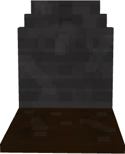
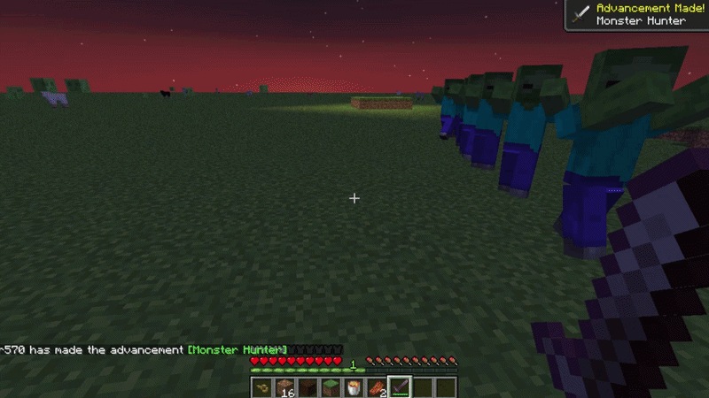

# Final Rest

## Never lose your items to lava or despawn timers again!
## 
Final Rest is a Minecraft mod that safely secures your inventory inside a unique grave whenever you die. Upon death, you are granted a special key—head back to your grave, unlock it with the key, and instantly reclaim your lost belongings.

## ✨ Features

Automatic Grave Generation: Spawns a grave right at your exact coordinates when you perish.

# 

🔑 Soulbound Keys: Receive a unique key upon death linked specifically to your grave.

🔒 Secure Storage: Keeps your inventory completely safe from despawning, lava, or explosions.

⚡ Simple & Intuitive: Just right-click your grave with your matching key to retrieve all items instantly.

## 🛠️ Installation & Setup

Make sure you have Fabric Loader installed for your game version.

Download the latest version of Final Rest from Modrinth or CurseForge.

Place the .jar file into your Minecraft .minecraft/mods folder.

Launch the game and enjoy stress-free exploration!

## 📜 License

This project is licensed under the GNU General Public License v3.0 (GPLv3).

You are free to copy, distribute, and modify this software as long as all modifications remain open source under the same license terms.